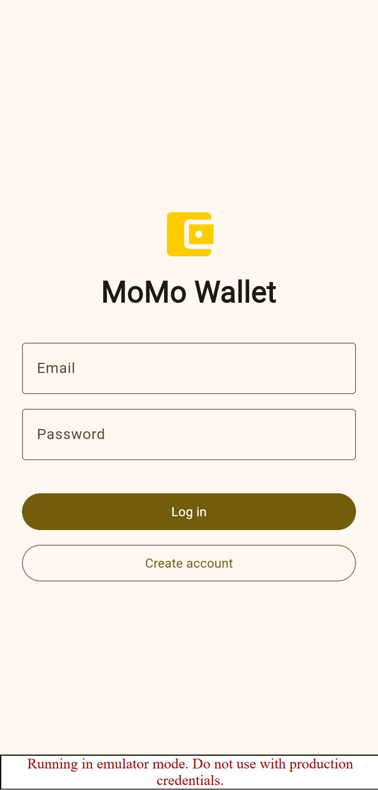
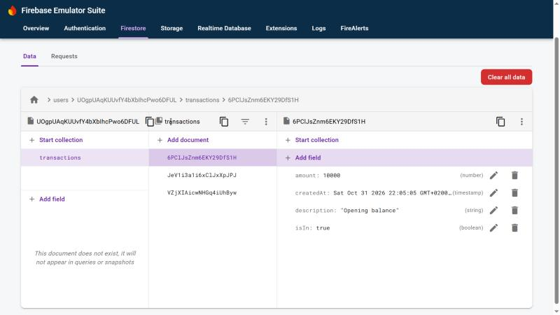
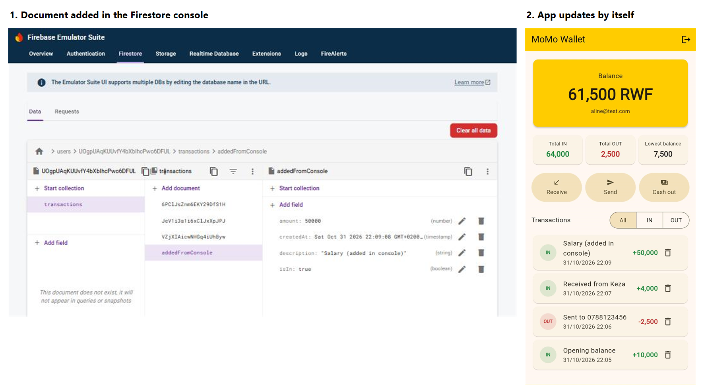
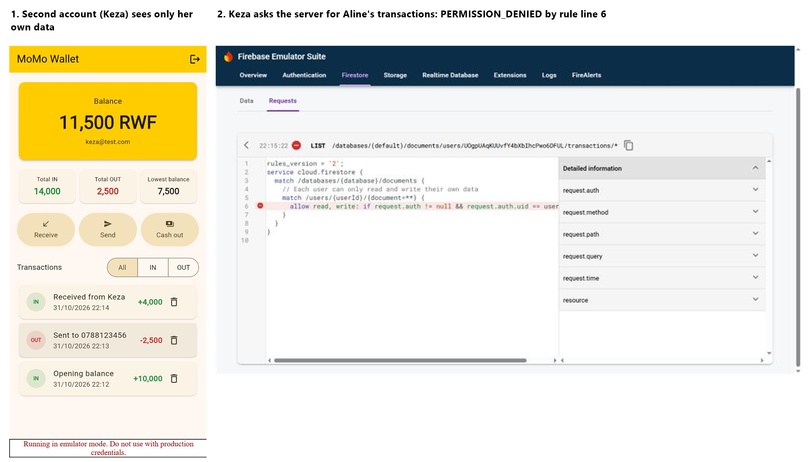

# MoMo Wallet

A Flutter mobile-money wallet: money comes in, you send it to friends, you cash out at an agent, and the balance is always computed from the transactions. It signs users in with Firebase Authentication, and each user's data is saved in Cloud Firestore under their own id, so two accounts never see each other's data, and every change appears live.

## Screenshots

### Login


### My data in Firestore
Each transaction is one document in `users/{uid}/transactions`, with `description`, `amount`, `isIn` and `createdAt`.



### Live update
A transaction added in the Firestore console appears in the app by itself, without restarting it.



### Second account sees nothing of mine
A second account sees only its own data. Asking the server for the first account's data is refused by the security rules.



## How it works

- **Accounts**: `login_screen.dart` creates accounts and logs in with email and password, with clear messages for wrong input. `auth_gate.dart` listens to `authStateChanges()` and shows the login screen or the wallet. The wallet has a log out button.
- **Firestore**: `wallet_store.dart` reads and writes `users/{uid}/transactions`. A new account gets three sample transactions (Opening balance +10,000, Sent −2,500, Received from Keza +4,000).
- **Live**: every screen listens with a `StreamBuilder` on `snapshots()`, and shows a loading, error or empty state when needed.
- **Edit and delete**: tap a transaction, then **Edit transaction**. Long-press or tap the bin to delete, after an *Are you sure?* dialog, with **Undo**.
- **Save facts, compute the rest**: only transactions are saved. The balance, Total IN, Total OUT and lowest balance are computed from them every time (`wallet.dart`), so they can never disagree.

## Security rules

Production mode, never test mode. Each user can only read and write under their own id ([firestore.rules](firestore.rules)):

```
match /users/{userId}/{document=**} {
  allow read, write: if request.auth != null && request.auth.uid == userId;
}
```

## Run

```bash
flutter pub get
flutter test
flutter run
```

To run without a Firebase project, start the Firebase Local Emulator Suite (`firebase emulators:start --project demo-momo-wallet`) and run with `--dart-define=USE_EMULATOR=true`. The screenshots above were taken this way.
